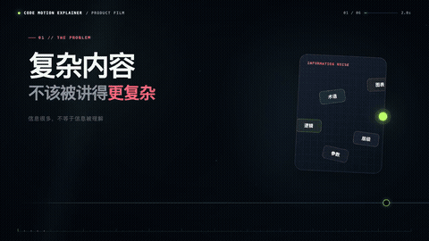
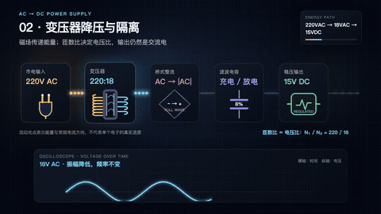

<div align="center">

# Vibe Motion

### Prompts → Code → Motion Graphics

用代码把想法变成可编辑、可复用、可确定性渲染的动态图形。

[官方网站](https://vibe-motion.github.io/) ·
[2D 脚手架](https://github.com/vibe-motion/create-vibe-motion) ·
[自动化工作流](https://github.com/vibe-motion/auto-motion) ·
[Agent Skills](https://github.com/vibe-motion/skills)

</div>

---

## 新能力：Code Motion Explainer

`remotion-code-motion-explainer` 是一套面向 AI Agent 的代码动画导演工作流。它可以把脚本、
旁白、字幕、产品流程、技术原理或参考视频转化为连续、可编辑、可参数化的 Remotion 动画。

<p align="center">
  <a href="https://github.com/vibe-motion/skills/blob/main/remotion-code-motion-explainer/assets/showcase/code-motion-promo-30s.mp4">
    
  </a>
</p>

<p align="center">
  <strong>点击画面播放 30 秒宣传片</strong>
</p>

它不只是“让元素动起来”，而是把解释编译成一条可见的因果链：

```text
语言与事实
    ↓ 语义拆镜
持续空间与对象状态
    ↓ 参数化 Remotion 组件
逐帧渲染与 QC 证据
    ↓
可交付成片 + 可复用镜头资产
```

### 能做什么

| 能力 | 适用场景 | 输出 |
| --- | --- | --- |
| 产品与 AI 工作流 | 产品发布、Agent 协作、软件演示 | UI 状态、操作反馈、数据流 |
| 技术与科学原理 | 算法、电路、物理、系统架构 | 波形、流程、公式、空间模型 |
| 高保真动效复刻 | UI 录屏、参考视频、AE 成片 | 几何锚点、节奏分段、参数化复刻 |
| 数据叙事 | 指标、关系、趋势、证据链 | 图表、计数器、时间线、关系图 |
| 视频生产系统 | SRT 卡点、A-roll/B-roll、声音事件 | 分层渲染、联系表、QC 与复用记录 |

### 原理动画能力展示

下面的示例用一条连续电路说明：
`220V AC → 变压 → 全桥整流 → 电容滤波 → 稳压 → 15V DC`。

<p align="center">
  <a href="https://github.com/vibe-motion/skills/blob/main/remotion-code-motion-explainer/assets/showcase/ac-to-dc-explainer.mp4">
    
  </a>
</p>

<p align="center">
  <strong>点击画面播放完整能力片</strong>
</p>

### 技术路线

- React + Remotion 负责确定性时间线与组件化生产。
- SVG / HTML 负责大多数可编辑界面、图表、波形和信息图。
- Canvas / WebGL / Three.js 用于粒子场、复杂路径、空间镜头和必要的 3D。
- 字幕或显式 beat timeline 负责语义卡点。
- 持续对象注册表负责跨镜头身份、位置和状态衔接。
- 静帧、运动窗口、联系表与最终冻结帧差分共同构成视觉 QC。

### 内置镜头库

Skill 同时附带一套可编辑 Remotion 镜头库，目前包含 **63 个可检索镜头条目、65 个
已注册 compositions**：

- 竖屏字幕、数据、通知、品牌落版和媒体揭示；
- 横屏 A-roll / B-roll、证据链、章节与关系图；
- AI 产品网格、Prompt → Agent、语音 Persona 与卡片时间线；
- 霓虹路径、响应式 UI、玻璃仪表盘、渐变场和透视网页展示；
- SRT 驱动知识世界与完整生产时间线。

镜头不是不可编辑的视频模板。每个系统都保留源码、Props、构图逻辑和转换契约，可按品牌、
画幅、数据与语义重新组合。

### 安装并使用

```bash
npx skills add vibe-motion/skills
```

然后向 Agent 发出类似请求：

```text
使用 $remotion-code-motion-explainer，把这段产品说明制作成 16:9 的连续代码动画。
每个操作必须产生可见结果，保留可编辑参数，并输出联系表与 QC 证据。
```

---

## Vibe Motion 工具链

### 1. 自动从 SRT 生成动画

[`vibe-motion/auto-motion`](https://github.com/vibe-motion/auto-motion) 将字幕拆成镜头任务，
组织代码动画生产并输出完整视频。

### 2. 2D 程序化动画

```bash
npm create vibe-motion@latest my-app
```

[`create-vibe-motion`](https://github.com/vibe-motion/create-vibe-motion) 提供基于 Remotion 的
动态图形脚手架。

### 3. 3D 程序化动画

```bash
npm create vibe-motion-3d@latest my-app
```

[`create-vibe-motion-3d`](https://github.com/vibe-motion/create-vibe-motion-3d) 使用 Three.js
与确定性帧序列渲染构建 3D 动画。

### 4. AI Agent Skills

[`vibe-motion/skills`](https://github.com/vibe-motion/skills) 收录可安装的动效 Skills，包括
代码动画导演、SVG 组装、金融 K 线、聚光灯文字、3D 照片墙、黑胶唱片机、地球飞线、
微信聊天动效等。

---

## 加入 Vibe Motion Dev Team

- [提交加入申请](https://github.com/vibe-motion/.github/issues/new?title=%E7%94%B3%E8%AF%B7%E5%8A%A0%E5%85%A5%20Vibe%20Motion&body=%E4%BD%A0%E5%A5%BD%EF%BC%8C%E6%88%91%E6%83%B3%E5%8A%A0%E5%85%A5%20Vibe%20Motion%20%E7%BB%84%E7%BB%87%E3%80%82%0A%0A%E6%88%91%E7%9A%84%20GitHub%20%E8%B4%A6%E5%8F%B7%EF%BC%9A%40%0A%0A%E6%88%91%E6%84%9F%E5%85%B4%E8%B6%A3%E7%9A%84%E6%96%B9%E5%90%91%20/%20%E6%83%B3%E5%81%9A%E7%9A%84%E5%86%85%E5%AE%B9%EF%BC%9A%0A)
  并填写 GitHub 账号与希望参与的方向。
- 等待维护者审核并添加 `invite-to-org` 标签。
- 在 GitHub 通知或注册邮箱中接受组织邀请。

欢迎贡献新的镜头、Skill、渲染器、示例项目、质量验证工具与动效研究。

## 社区

- [官方网站](https://vibe-motion.github.io/)
- 飞书交流群：


